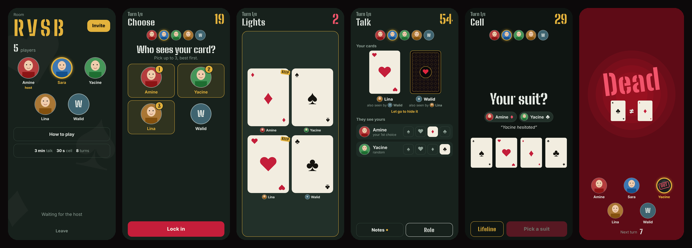

# Jack of Hearts: Solitary Confinement

A phone game based on the Jack of Hearts game from *Alice in Borderland*, for 3 to 20 friends in the same room. Each turn you choose who to trust with your card, glimpse every card but yours, keep two, talk, lie, and then name your own suit alone in your cell. Get it wrong and you're out. One of you is the Jack.



## Start a game

One device runs the game: a PC, or an Android phone. Everyone else just opens a web page. Nobody installs anything, and no internet is needed once the game device is set up.

### On a PC (Windows, Mac or Linux)

1. Install [Node.js](https://nodejs.org) 24 (LTS), or 22.13 or newer.
2. Extract the ZIP, open a terminal in the `jack-of-hearts` folder and run:
   ```bash
   npm start
   ```
3. Everyone joins the same Wi-Fi (or one phone's hotspot) and opens the **Other phones** address it prints, like `http://192.168.1.23:3000`. Or scan the QR code under **Invite** in the lobby.

On Windows, allow Node through the firewall the first time, and set the network to *Private*.

### On an Android phone, no PC

1. Install **Termux** from [F-Droid](https://f-droid.org/packages/com.termux/) (the Play Store version is outdated). In Termux, once, with internet:
   ```bash
   pkg install nodejs unzip
   termux-setup-storage
   ```
2. Put the ZIP in your Downloads, then unpack it into Termux:
   ```bash
   unzip -o ~/storage/downloads/jack-of-hearts-v5.9.zip -d ~   # -o replaces an older version
   cd ~/jack-of-hearts
   ```
3. Start it, and turn on your hotspot:
   ```bash
   termux-wake-lock   # keeps Android from pausing the game
   npm start
   ```
4. On this phone, open `http://localhost:3000` in Chrome. Friends join your hotspot and open the address under **Invite** in the lobby.

Recent Android versions don't let Termux read the phone's own network address. If **Invite** has no QR code yet, a friend opens their Wi-Fi details and uses the **Gateway** (or **Router**) address with `:3000`, like `http://192.168.43.1:3000`. As soon as one phone is in, the QR code appears for everyone else.

### Next time

`npm start`, open the address, play. Your name and photo are remembered on each phone.

## How to play

1. **Choose (20 s).** Every turn starts here. Pick who sees your card: rank up to 3 people (just 1 with 4 or fewer players). Each person can be chosen by only 2 players, the 2 fastest. A second viewer is added at random. Every card is seen by exactly 2 people, and everyone holds exactly 2 cards.
   **With 4 or fewer players it's 1 and 1:** each person goes to the fastest player who chose them, nobody is added at random, your card is seen by that one person only, and you hold 1 card.
2. **Lights (5 s, or 3 s with 5 or fewer players).** Every card but yours shows on screen, with nothing to hold.
3. **Plotting (45 s; the host can set 15 to 90 s).** A big clock on every phone. You now know who holds your card and whose cards you'll hold, with the other person who holds each one ("also seen by"), but you can't look at any card yet: only your memory of the lights. Argue about the last result, make deals, set traps. If the interrogation vote is open, this is when it happens.
4. **Talk.** Hold one of your cards to look at it again; under each one, "also seen by" names the other person who holds it (with 4 or fewer players, nobody else does). Note what your viewers tell you. Trade, promise, lie.

   **Skip.** In Plotting and the talk, everyone has **Skip** at the top (it shows how many have tapped it, e.g. "Skip 3/5"; tap again to take yours back). The phase ends early only when every living player has tapped it. Nobody can skip alone, not even the host.
5. **Cell.** Your notes are on screen. Pick your own suit. Wrong, or no answer, and you're out. This is the only place your lifeline works, and it doesn't on the last turn.
6. **Results.** ALIVE, DEAD or SAFE in the middle of the screen; everyone's mugshot shows who's still in.

**Private chat.** Tap **Chat** at the top of the screen (while choosing, in Plotting, the talk and the cell) to message any living player. Only the two of you ever see a conversation, and nobody else's phone is even told that you're talking. It's open the whole game except in your cell (you can still read there), and the dead can't write. It's always open in Plotting, text only. In the talk it's closed unless the host switches on **Settings → Chat → Private chat in the talk** (off by default): so in the talk everyone has to talk to each other (you can still read what was written), and the chat opens again while choosing and in Plotting. The number on **Chat** counts the messages you haven't read. A message is at most **10 words**; tap a ready-made phrase ("Your card is", "I trust you", "You lied to me" …) or a suit button to add it.

**Voice messages** (off by default; the host switches them on under **Settings → Chat → Voice messages**, for games played apart: in one room everyone would hear them). They live in the talk's private chat, so switching them on also opens the chat in the talk, and switching the chat in the talk off ends them too. Only during the talk, never in Plotting: with the message box empty, **Voice** takes the place of Send. Tap it, talk, then **Send**, or **Cancel**; at 20 seconds it stops and sends by itself. A voice message goes to that one player only, like a text, and counts toward the same speed limit, with at most 10 per player per talk. The server keeps a clip only until the talk ends; your phone keeps the ones it got, so you can still play them in your cell. On the website the microphone works only on the secure (https) address, not on a Wi-Fi address like `192.168…:3000`.

The moment the Jack is out, everyone still in wins. The Jack wins by surviving until one other player is left, or until the turns run out. Once per game, in your cell, you can peek at your own card (Lifeline), except on the last turn. One secret turn has the collars off; it's never the last turn, and the host can switch it off under **Settings → Game → Safe turn** (then every turn counts). Cards are dealt fresh every turn: repeats and streaks are normal.

**The Jack can't always see.** Everyone knows how many of these there are (the lobby shows the settings), but only the Jack learns which turns:

- **Colour turns** (default 2): the Jack sees only **red** or **black**, in the lights and on the cards he holds. He still has to tell those players something, and a wrong suit in the right colour is his signature.
- **Blank turn** (default 1): one of the 2 cards he holds is blank.
- **Fakes** (default 2 a game): while choosing, the Jack holds a player's picture for 1 second, and one of the people holding that player's card sees a false suit on it, in the lights and the talk. That holder then tells the wrong suit without knowing it. Not on his colour or blank turns, so he can't use a fake to hide his own guess. If nobody but the Jack holds that card, the fake is given back.

Holding **Role** (while choosing, in Plotting or in the talk) tells the Jack this turn's sight, and after a fake, whose card he faked and who got the false suit: "You faked Sara's card: Omar gets a false suit." It never says which suit Omar sees; the server doesn't send it to the Jack's phone. Game Over shows every fake in full.

**Interrogation vote** (on by default). Once a game, in Plotting, right after the lights, more than half of the living players can vote one player into interrogation for the rest of that turn: everyone glimpsed their card in the lights, so it's swapped for a new one nobody has seen; nobody holds it, they hold nobody's (those cards keep their other holder), and they can't use their lifeline, so they guess their suit alone. Since everyone already knows who holds whose card, you can vote out the one you don't trust with yours. Tap a name to vote; the counts show, never who voted. The vote opens right after the first half of the game if nobody died in it (8 turns: from turn 5), otherwise 2 turns before the end (8 turns: turn 6), and only with more than 4 players left.

The host sets all of these in **Settings**, in groups: **Time** (Plotting, talk, cell), **Game** (turns, safe turn, interrogation vote), **The Jack** (colour turns, blank turns, fakes; 0 turns each one off), **Chat** (private chat in the talk, voice messages) and, on the host's phone only and marked in red so it's never read out, **Secret** (the Jack's secret power below). The lobby shows everyone the same groups, without the secret one.

**How to play** (in the lobby, and in the ⋯ menu during a game) shows all this as slides: one idea a page, a still picture made of the game's own cards and buttons, and When / How / Then for every power. The times and counts on the slides are the room's own settings.

House rules: never show your screen, no talking in the cell, the dead stay silent.

## For the host only: the Jack's secret power

*Spoiler. The other players aren't told this exists until it hits them, so don't read it out.*

Once per game, on any turn but the last, the Jack can **black out a cell**. During the talk he holds **Role** as usual, and keeps holding: a moment after his card shows, a thin gold frame starts tracing round it, and when it closes (2 seconds in all) that turn's cell is blacked out. Letting go before it closes does nothing, so a quick look at his role is always safe.

In that cell, anyone else who uses their lifeline gets **BLACKOUT** instead of their card, and the lifeline is gone for good. The Jack's own lifeline still works. Nobody can warn anyone, because nobody talks in the cell. At the end, the Game Over screen shows which turn it was, and nothing about lifelines: not who used one, nor whether anyone did. On the last turn there are no lifelines, so the blackout isn't offered then.

It's on by default. The host can switch it off under **Settings → Secret → Jack's secret power**, a switch that only appears on the host's phone. If the Jack starts winning most games, switch it off.

Under it, **Reveal it at the end** decides what the Game Over screen says. On (the default), it says which turn the Jack blacked out. Off, it says nothing: nobody ever learns whether the Jack used his power at all, not even after the game.

### What's different from the show

| | Original | This game |
|---|---|---|
| Who sees your collar | Everyone in the prison, all the time | Everyone, for a 5-second glimpse (3 s with 5 or fewer players). After that, exactly 2 people: one you choose, one at random. With 4 or fewer players, just the one you choose |
| Round length | One hour, with answers given in the cell during the last five minutes | Configurable: 1 to 10 minutes of talk, 15 to 60 seconds in the cell |
| End of the game | No round limit. The pressure came from visas running out outside | Turn limit (default 8). Without one, a fully honest table would never end |
| The Jack | In the manga, the Jack's prosthetic eye was linked to his collar | The Jack can't see their own suit. Otherwise the players could only win if the Jack chose to lose |
| Cheating | Reflective surfaces banned | The lights last a few seconds, the cards you keep show only while you hold them, and showing your screen is banned |
| Private talk | Anywhere in the prison, face to face | A private chat between any two living players, closed in the cell |
| Extras | — | Mugshots, one lifeline each, one secret safe turn, private notes |

## Version 6.0

- **The Jack can't always see.** Colour turns (red or black only), a blank turn (one held card blank) and fakes (a holder sees a false suit). A Jack who never lies used to win almost every game; now he has to say something on turns he can't see, and his mistakes point at him.
- **The safe turn is a switch.** **Settings → Game → Safe turn**, on by default and shown to everyone in the lobby; off, every turn is deadly.
- **Plotting, after the lights.** Every turn, the first too, now goes: choose → lights → Plotting, where you know who holds your card and whose cards you hold, but can't look at any card → talk → cell. The countdown at the start of each turn is gone. Plotting lasts 45 seconds; the host can set 15 to 90 under **Settings → Time → Plotting**.
- **Interrogation vote.** Once a game, in Plotting, a majority can send one player into interrogation: their card is swapped for one nobody has seen, nobody holds it, they hold none, no lifeline.
- **Holding works in phone browsers.** A long press no longer selects text or opens a menu, so Role, your cards, the lifeline and the Jack's fake can be held on the website too.
- **Harder to capture on the website.** The game is covered whenever you leave it (switching apps, the notification shade, another window) and when Print Screen is pressed, and printing shows nothing. On a computer it's covered while the Windows or Cmd key is down, so every screenshot shortcut (Win+Shift+S, Win+PrtScn, Cmd+Shift+3/4/5) catches a blank screen. On a phone it's covered while 3 fingers touch the screen (the 3-finger screenshot swipe; 2 fingers stay fine, for holding both your cards). A website still can't block a phone's screenshot buttons, because the phone never tells the page; the app does block them.
- **Host settings** for all of these, shown to everyone in the lobby.
- **Shorter private chat.** 10 words a message, with ready-made phrases and suit buttons; suits in messages are drawn as small cards in their colours, with a preview while you type.
- **A Role button while choosing**, the same for everyone.
- **The host can close the room** for everyone: in the lobby, at Game Over, or during a game. It's a hold, so a stray tap never ends anyone's game. Every other phone goes back to the start screen with "The host closed the room."
- **A ⋯ menu during the game**: how to play, leave the game (a hold), and for the host, close the room.
- **Nobody waits for someone who left.** If the last player everyone was waiting for leaves while choosing or in the cell, the turn goes on at once.
- **Game Over reveals the Jack's secrets**: his colour and blank turns, and every fake (who saw what, and what it really was).
- **The Jack isn't told what his fake shows.** Role says only "You faked Sara's card: Omar gets a false suit.", never the suit Omar sees.
- **Settings in groups**: Time, Game, The Jack, Chat, and the host's red Secret group; the lobby shows everyone the same groups.
- **A new Jack of Hearts card**: one large portrait instead of two small mirrored ones, so it reads on a phone. A masked young man with narrow red eyes, a thin moustache and a sly smile, in a crimson beret with a gold plume and a white ruff, in front of a heart-shaped halo under a gold art-deco arch. The source is `app/assets/art/jack-of-hearts.svg`; `app/assets/jack-card.png` is it at 600 × 840.
- **The private chat in the talk is a switch** (off by default). Off, the private chat is open only while choosing and in Plotting (always, text only), so in the talk everyone has to talk to each other; what was written before can still be read.
- **Voice messages in the private chat**, a host switch (off by default; on, it opens the chat in the talk too): during the talk only, up to 20 seconds, to one player only. In the browser they're recorded as MP4 (AAC) when the browser can, which every phone plays; Firefox records Ogg, which an iPhone may not play. The app needs a new build for it (microphone permission, `expo-audio`).
- **Everyone skips together.** Skip used to be the host's alone, in the talk. Now every living player has it, in Plotting and in the talk, and the phase ends only when all of them have tapped it.
- **"also seen by"** under each card you hold names the other holder, and stays on one line with long names.
- **How to play is slides**, with Back and Next and nothing animated, so it costs a phone nothing. Every power says when and how to use it, with the room's own times and counts. The blackout page shows only on the host's phone and the Jack's, so it stays a surprise for everyone else.
- **The first card flip shows its suit at once.** The suit pictures load when the game opens; in the browser the very first flip of a game used to show an empty face for a moment.

## Version 5.9

- **A 45-second countdown opens every turn after the first.** Everyone sees the same big clock, the players who are out too. The cards are dealt face down; tap one and it says the turn hasn't started yet, with the time left. Nobody chooses until the clock runs out. Turn 1 starts straight away.
- **Private chat.** **Chat**, at the top of the screen while you play (the countdown, choosing, the talk and your cell), lists the players; pick one and write. Only the two of you receive a conversation: the server sends it to nobody else and changes nobody else's state. It's closed in your cell (you can read, not write), the dead can't write and can't be written to, and each game starts with an empty chat. A phone that reconnects gets its conversations back, and remembers what you've read.
- In the browser, the chat's message box stays above the keyboard on Android (the page tells the browser to shrink instead of being covered).

## Version 5.8

- **The Expo app is on Expo SDK 58** (React Native 0.88, React 19.3). Expo Go from the Play Store only opens SDK 58 projects now, so 5.7 stopped loading in it ("this project uses SDK 57"). After unpacking, run `npm install` in `app` again. Expo's tools now need Node.js 22.13 or newer, or 24.3 or newer.
- **Fixed: "Your cell" was cut short in the browser.** The big word between phases is sized to fit the screen. The app shrinks text that doesn't fit by itself, but browsers don't, so on a narrow phone it showed "Your c…".

## Version 5.7

- **The host chooses whether the end reveals the blackout.** A new host-only switch, **Settings → Reveal it at the end**. On, Game Over says which turn the Jack blacked out. Off, it says nothing, and nobody ever learns whether he used it.

## Version 5.6

- **The end never says anything about lifelines.** The Game Over screen still says which turn the Jack blacked out, but not who used a lifeline, or whether anyone did. The server only sends the turn, so no phone can show more.
- **No lifelines on the last turn.** The cell says so on everyone's phone, used lifeline or not. With nothing to block, the Jack's blackout isn't offered on the last turn either.
- **The safe turn is never the last turn.** A safe last turn would just run the clock out and hand the Jack the game.

## Version 5.5

- **The lights show the cards straight away.** No need to hold the screen: every card but yours is there for the 5 seconds (3 with 5 or fewer players), dealt in as the lights come on.

## Version 5.4

- **No KEEP label in the lights.** You see every card but yours, and nothing marks the ones you'll keep: you find out in the talk. A glance at someone's screen during the lights no longer shows whose cards they hold.

## Version 5.3

- **Every role card is the same card back.** Holding **Role** used to show the Jack his own face card, which stood out from across the table. Now everyone sees the same back. The Jack's has his face drawn into the heart (narrow eyes, sharp brows, a thin smile) in 15% black: he can make it out in his hand, but from 2 m away it's a plain heart.
- **The blackout takes a 2-second hold** instead of about 4, so arming it looks more like an ordinary look at your role. The frame starts after 0.6 s and closes at 2 s.

## Version 5.2

- **Fixed: a blank white card in the Android app.** The card you hold, and your card when you use the Lifeline, turned over with a 3D rotation. The Android app (Expo Go) drew the card but not the suit printed on it. Cards now turn over flat: they narrow to their edge, swap sides and widen again.

## Version 5.1

- **Fixed: the suits didn't show on some Android phones.** Cards, the suit buttons, your notes and the Lock in button showed no ♠ ♥ ♦ ♣. Every suit is now drawn as an image, so it looks the same on every phone (see *Why the suits are pictures* below).

## Version 5

- **4 or fewer players: 1 and 1.** You hold 1 card, and yours is seen only by the person you chose, if you were the fastest to choose them.
- **The lifeline moved to the cell.** It's the last thing you can do before you answer, alone. The talk screen is down to your cards, your notes and your role.
- **The Jack's secret power**, the blackout (see above). On by default; the host can switch it off.
- **Role screens look the same from across the table.** Everyone gets one black-and-gold card, the same gold glow, a gold line of the same length and two lines of text under it.

## Version 4

- **A real Jack of Hearts**: an original black-and-gold court card with one red eye, used for the logo, the app icon, your role and the final reveal. The source is `app/assets/art/jack-of-hearts.svg`.
- **Mugshots**: take a photo or pick one when you join, preview it, change it any time. Everyone in the game sits in a row of mugshots at the top of every screen. Out players go grey, veiled and stamped OUT, with a shake when it happens.
- **Results in the middle**: ALIVE with a gold burst, DEAD with a red flash and shake, SAFE with your private verdict, GAME CLEAR or JACK WINS with the Jack card turning over.
- **Less reading**: short labels, rules and settings behind buttons, no scrolling during play on phones from 360×640 up.
- **Motion with a purpose**: cards flip in 3D, the lights flash, the last seconds of the cell pulse behind the cards, each phase opens with one big word. Phones set to reduce motion get simple fades.
- **One self-contained ZIP**: `npm start` from the top folder, the server's packages and the built web app included, works on a PC or in Termux.

## The Expo app (optional)

The browser version is the simplest. To also run the native app (screenshot blocking, keeps the screen awake everywhere) through Expo Go, or build an APK:

```bash
cd app
npm install        # needs internet once
npm start          # Expo, offline; scan the QR code with Expo Go
npx eas-cli@latest build -p android --profile preview   # an installable APK, built in Expo's cloud
```

Keep that terminal running while you play: Expo Go loads the game from it, and shows "Cannot connect to Expo CLI" when it stops. The game itself still needs `npm start` in the top folder too.

The app guesses the server address; if it can't reach it, tap **Server** at the bottom of its home screen and type the address `npm start` printed. This project uses Expo SDK 58 (Expo's tools need Node.js 22.13+ or 24.3+); update Expo Go if it says the project is incompatible.

After changing the app's code, rebuild the browser version with `cd app && npx expo export --platform web`.

## Playing over the internet

Deploy `server/` to any Node host that supports WebSockets. It reads `PORT` and `HOST` from the environment and has a `GET /health` route.

---

## How it works

### The server is the game

The app never decides anything. It sends **intents** ("I trust Sara, then Amine", "I'm answering hearts") and renders the **state** the server sends back. All the rules live in `server/src/game.js`, a plain class with no sockets, no timers and no I/O. `server/src/app.js` is a thin adapter that turns socket events into method calls and pushes the results out.

The split keeps the rules testable without a network (`test/game.test.js` runs them in milliseconds) and lets you swap the transport later, for example adding a REST API or another kind of client, without touching the rules.

### Hidden information: one view per player

A Socket.IO room broadcast (`io.to(code).emit(...)`) sends the same bytes to everyone. That's fine for chat but fatal here. Instead, `broadcast()` loops over the players and sends each one `game.viewFor(playerId)`:

- your own card is never in it;
- during the lights it holds every other player's card; during the talk, only the cards you hold (2, or 1 with 4 or fewer players); in the cell and everywhere else, none;
- you're told who holds your card, which cards you hold, and who else holds each of them, but never the whole map;
- your ranking is visible to you only, and who got whom stays secret until the lights;
- only the Jack is told they're the Jack, and everyone learns who it was only at the end;
- only the Jack's state says whether his blackout is ready, on or used, and only the host's state carries the switch for it;
- at the end, everyone learns which turn was blacked out, and nothing about lifelines: the server sends only the turn, so no phone can show who used one or whether anyone did;
- the safe turn is stored on the server and revealed only after everyone has answered;
- private messages are never in it at all (see below);
- tokens are never included.

So once you're in your cell, the phone genuinely has no cards to show anyone, even to someone digging through it with devtools. Online card games use the same pattern so they never send your opponents' hands to your browser. The socket test plays a full game and checks every message every client received.

The **lifeline** is the one exception: your own card comes back in the reply to your `turn:lifeline` request, to your socket only, never in the shared state. The app shows it for one second and forgets it. During a blackout the reply is `{ blackout: true }` instead, and the lifeline is spent either way.

### Side channels: even an empty message is a clue

When the Jack sets the blackout, only his own view changes. The easy code would still send a fresh state to every phone, as every other action does. But then anyone watching the traffic would see a message arrive during the talk with nothing different in it, and learn that something invisible just happened. Since only the Jack can do anything invisible, that alone gives the blackout away.

Leaking information through *whether* or *when* a message is sent, rather than through what it says, is called a **side channel**. So `turn:blackout` and `turn:lifeline` answer with `sendTo()`, which updates only the player who acted. The socket test checks that no other phone receives a single message when the Jack sets the blackout, and fails if you swap `sendTo()` back to `broadcast()`.

The **private chat** follows the same rule. A message changes nobody's state, so there's no broadcast at all: the sender gets it back in the reply to `chat:send`, the receiver gets one `chat:message` event, and every other phone gets nothing. Even a chat-wide "someone sent something" ping would tell the table that two players are scheming right now. The messages live in the room on the server, one thread per pair (the last 100 each), so a phone that reconnects asks for `chat:history` and gets its own conversations back, and nobody else's. Your phone remembers which ones you've read. The socket test checks that a third and fourth phone receive nothing while two players talk.

### Dealing the cards: random on purpose, never evened out

Each turn, `#beginTurn()` gives every living player `SUITS[randomInt(4)]`: an independent 1-in-4 draw from `crypto.randomInt`, which is backed by the operating system's cryptographic randomness. Unlike `Math.random()`, nobody can predict the next draw from earlier ones, and it uses rejection sampling, so ranges that aren't a power of 2 (picking the Jack among 5 players) carry no *modulo bias*. Dealing 20 cards takes under a microsecond.

Real randomness looks streaky. With 5 players, 3 or more share a suit in 41% of turns, and in 150,000 dealt cards one player kept the same suit 9 turns in a row. People read that as "not random", and the usual fixes make the game worse, because of the glimpse:

- **Even the suits out** (a bag with each suit once, or dealing from one shuffled deck): with 4 players and one of each suit, you'd see the 3 other cards and know yours is the missing one. A 52-card deck leaks less, but it still leaks: if the others show lots of diamonds, yours is less likely to be one.
- **No repeats from last turn:** survivors know last turn's card (they answered right), so they'd be choosing from 3 suits instead of 4.

Independent draws are the only dealing where everyone else's card, and your own history, tell you nothing about your card. A test in `game.test.js` plays 4,000 turns and fails if the suits are uneven, if your card depends on your last one, or if it depends on the cards around you, so neither "fix" can sneak in later.

### Choosing who sees whom: `viewers.js`

Two steps, each a small, separately tested function.

**1. `resolveChoices()`: first come, first served.** The game keeps lock-ins in a `Map`, which in JavaScript remembers insertion order, so the order of the `Map` *is* the order of the race. Going through it in order, each player gets their highest-ranked choice that fewer than 2 people have already got. Players who didn't lock in, or whose choices were all taken, are handled after every real choice, in random order, so a random fill can never take a seat that someone actually asked for. There's always room for them: for everyone else to be full, they'd need twice as many choices as there are other players.

**2. `assignViewers()`: the random viewer, so the numbers come out exactly 2 and 2.** Think of each player as having 2 *seats*: the cards they'll hold. Someone chosen by 2 people has no free seat left; someone chosen by nobody has 2. Each card needs exactly one more viewer, and there are exactly as many free seats as cards. So the random viewers are a way of handing every card one free seat, with two restrictions: never your own seat, and never the seat of the person who already holds your card.

The hand-out is a fair draw by *rejection sampling*: shuffle the free seats, hand them out, and if any card breaks a restriction, throw the whole draw away and shuffle again. Every arrangement of the seats is equally likely and only broken ones are thrown out, so every arrangement that follows the rules is equally likely. With 8 to 20 players a shuffle is valid 11 to 36% of the time, so it takes a handful of tries, well under a millisecond.

Could it ever be impossible? No, with 3 or more players. This is a *perfect matching* problem (cards on one side, free seats on the other), and *Hall's marriage theorem* says a perfect matching exists unless some group of cards has fewer allowed seats than cards. Each card rules out at most 2 people, and anyone with a free seat is ruled out by at most 2 cards, which is never enough to block a group. An exhaustive check of every possible set of choices for 3 to 7 players agrees. The code still keeps a deterministic matching (Kuhn's augmenting paths) as a fallback, so it can never get stuck, and the tests run it on its own.

**3. Small games, `pairViewers()`: 1 and 1.** With 4 or fewer players, each card gets exactly one viewer and each player holds exactly one card, so each person can only go to the single fastest player who chose them. You might expect the same greedy pass to work with room for 1 instead of 2. It doesn't: if A picks B, then B picks A, then C picks A, the greedy pass gives B to A and A to B, and the only card left for C to hold is C's own.

So `pairViewers()` looks at every way to pair up the table where nobody holds their own card. In maths that's a **derangement**, and there are only 9 with 4 players (2 with 3). It scores each one in lock-in order (did the first player get their choice? then the second?) and keeps the best, comparing scores the way a dictionary compares words: the first difference decides. Ties are broken at random. In the example, A keeps B, C gets A, and B is picked for. Trying every option is fine here because the numbers are tiny; with 20 players there would be about 900 quadrillion derangements, which is why the big-game code works differently.

`otherViewer()` gives, for each of your cards, the one other person who holds it (nobody, in a small game).

Every function takes the random number generator as a parameter. The game passes `crypto.randomInt`, which is backed by the operating system's cryptographic randomness; tests pass fakes to get predictable results. That's *dependency injection*, the same trick `game.js` uses for the clock.

### A state machine with timers owned by the server

```
lobby ─start─▶ choose ─20 s or all locked in─▶ lights ─3 or 5 s─▶ briefing ─45 s─▶ discussion ─timer or skip─▶ confinement
                  ▲                                                                                                   │
                  │                                                                                 timer or all answered
                  │                                                                                                   ▼
                  └───────────────────────────────── no winner yet: next turn ◀───────────────────────────────── reveal
                                                                                                                      │
                                                                                                winner decided ─▶ over
```

Every turn starts with choosing. From the lights on the viewers are assigned, so each phone gets `you.viewers`, `you.sees` and `you.sharedWith`; in the `briefing` no suit is sent at all. Players see the briefing as **Plotting**; it lasts `settings.briefingSeconds` (45 by default, 10 to 180). The briefing and the discussion also end early once every active player has skipped (`state.skip`: `{ count, needed, yours }`, null in the other phases). The interrogation vote, if open, is decided when the briefing ends.

Each room has one `setTimeout` that fires when the current phase ends and calls `game.advance()`. The server sends `phaseEndsAt`, a timestamp, rather than "seconds left", so a message that arrives late still shows the right countdown. Phone clocks can be off by seconds or minutes, so every state also carries `serverNow`. The app keeps `offset = serverNow - Date.now()` and counts down against server time.

### Why there are no locks: the event loop

Node runs your JavaScript on **one thread**. Socket.IO delivers events through the event loop, and each handler runs to completion before the next one starts. Nothing in the game logic `await`s.

So when two players lock in at the same instant, their `turn:choose` handlers run one after the other, never interleaved, and the one that ran first is first in the race. The player `Map` can't be left half-updated. That's why there's no mutex anywhere.

Two consequences to remember:

- If you add an `await` inside a handler later (say, a database write), other events can run during that wait, and you have to think about ordering again.
- Anything slow and synchronous freezes every room on the server at once.

### Request and response over a socket: acknowledgements

`socket.emit('turn:answer', { suit }, callback)`: the last argument is a function the server calls with its reply. Every handler goes through `handle()`, which replies `{ ok: true, ... }` or `{ ok: false, error, message }`. That gives you HTTP-style request and response over the open WebSocket. The app uses `socket.timeout(8000).emitWithAck(...)`, so a dead connection fails with an error instead of hanging forever.

### Phones sleep: reconnecting with a secret token

Creating or joining a room returns `{ playerId, token }`, and the app stores them in AsyncStorage. Socket.IO reconnects on its own after a screen lock, an app switch or a Wi-Fi drop. On every `connect` the app sends `room:resume` with the token and gets its seat back. If someone's phone is offline when their cell closes, their collar still goes off, as the original rules say. A player who leaves mid-game isn't shown in the lights, isn't given anyone's card and isn't anyone's viewer.

The token is 24 random bytes. It's the only proof that you are you, since anyone can type any name. It's compared with `crypto.timingSafeEqual`, so the time the comparison takes doesn't reveal how many characters matched. That's overkill for a party game, but it's the habit you want for every secret.

### Never trust the client

The UI already stops most mistakes, but anyone can open the web version's devtools and send whatever they like. So the server checks everything:

- names must be strings, trimmed to 16 characters and unique;
- a ranking must be an array of 1 to 3 different living players (just 1 with 4 or fewer players), never yourself, once per turn, during the choose phase;
- the lifeline works once per game, for living players, only in the cell, before they answer;
- the blackout works once per game, only for the Jack, only during the talk, and only if the host left it on;
- a suit must be one of the four;
- answers are accepted only in the cell, only from living players, once per turn;
- host-only actions are checked against the host;
- settings are clamped to sane ranges;
- a photo must be a JPEG, PNG or WebP under 200 KB, and its first bytes must really be that format;
- a private message must be text, between two different living players, once the game has started and never from the cell; it's trimmed, stripped of control characters and cut to 200 characters (whole emoji, not half of one), and nobody can send more than 5 in 5 seconds.

Each failure becomes a clean error reply, never a crash.

### Mugshots: the socket for changes, HTTP for the bytes

The phone crops your photo to a square, shrinks it to 256×256 and compresses it to a JPEG of about 20 to 40 KB (`app/src/photo.js`), then sends it once as a data URL in `player:photo`. The server checks it (`server/src/photos.js`) and keeps the bytes in memory with the room.

The photo itself is never in the state. Every state goes to every phone after every change, so 20 photos in it would mean resending most of a megabyte each time someone locks in. The state only carries a version number per player (`photo: 3`), and the app loads `GET /photo/ROOM/PLAYER?v=3` like any other image. Because a new photo means a new URL, the server can tell browsers to cache each one forever (`Cache-Control: immutable`): each phone downloads each photo once.

Why check the first bytes? The server hands these files to every browser in the room. If it accepted anything labeled "image", someone could upload an SVG or an HTML page with a script inside. Checking the *magic bytes* (`FF D8 FF` for JPEG, `89 50 4E 47` for PNG) plus `X-Content-Type-Options: nosniff` means only real pictures go out, served as pictures.

### Running the server on a phone

Three details make `npm start` work in Termux as well as on a PC:

- **It listens on `0.0.0.0`**, every network the device is on, not just `localhost`. Without that, other phones on the hotspot couldn't connect. `HOST` and `PORT` can override it.
- **It survives not knowing its own address.** The printed link and the QR code come from `os.networkInterfaces()`. Recent Android versions block the system call behind it, and Node throws ("uv_interface_addresses returned Unknown system error 13"). `server/src/network.js` catches that and returns "unknown" instead of crashing at startup. On a PC it also puts the real Wi-Fi address ahead of VirtualBox, WSL or VPN adapters.
- **It learns its address from the first phone that reaches it.** Every connection knows which local address it arrived on (`socket.request.socket.localAddress`). As soon as one friend connects using the Gateway address, the server knows its LAN address, and every lobby shows the QR code from then on.

The server sends that address in every state (`joinUrl`), and the lobby's **Invite** sheet draws it as a QR code on the phone (`qrcode-generator`, no internet needed).

### Memory and cleanup

Rooms live in a `Map` in memory, photos included. That's fast and simple, but if the server restarts, every game is gone, and the apps show "That game no longer exists". A sweeper deletes rooms that nobody has been connected to for 30 minutes, so a server left running for weeks doesn't slowly fill up.

### The app: React without a router

`src/Root.js` picks the screen from `state.phase`. The server's phase *is* the router, so no phone can sit on a screen that disagrees with the server. Screens are functions of the latest state plus a little local UI state, such as your ranking before you lock in, or the suit you've tapped but not yet locked in.

Your notes are the one thing the server never sees. `src/useNotes.js` keeps them in AsyncStorage under one key, tagged with the room code, the game number and your player id: they survive a reconnect or an app restart, and the first save of a new game replaces the last game's notes. The server's `gameNumber` exists only so a phone can tell a new game in the same room from the old one.

On phones, `Root.js` also keeps the screen awake and blocks screenshots and screen recording (`expo-screen-capture`) for as long as you're in a room. In the browser it asks for a screen wake lock, which browsers only allow on a secure page: `localhost` counts, so it works on the phone running the server, and quietly does nothing elsewhere.

Holding **Role** looks the same from across the table for everyone: the same card back dealt in the same way, the same gold glow, a gold line of the same length ("You are the Jack" or "You are innocent"), and two lines of small text under it. The Jack's text is about his blackout; everyone else's says "Find the Jack". The blackout's frame stays gold even once it's set, because a red one would stand out. The Jack's card back is marked: his face is drawn into the heart in 15% black, which he can make out in his hand but which melts into the red from a couple of metres away. The cards you keep work the same way as Role: they show only while you hold them, so you can't hand your phone over without letting go. During the talk only the card under your finger turns over, so a glance at your screen shows one card at most; with two fingers down, letting go of one doesn't hide the other. The lights are the exception: since 5.5 every card but yours is on screen for those 3 or 5 seconds without holding, so that's the moment to keep your phone to yourself.

### Why the suits are pictures, not text

Up to 5.0 the suits were text characters: ♠ ♥ ♦ ♣, each followed by an invisible *variation selector* (U+FE0E) that says "the plain text version, please, not the emoji". On a PC that works, because ordinary fonts like DejaVu Sans include the four suits. But a phone only draws a character if one of its fonts has it, and many Android phones have the suits only in their colour **emoji** font. Asked for the plain text version, the browser has no font left to draw it with, and the suit comes out blank.

You can reproduce it on any computer: start Chromium with a font configuration that only knows one font without suits (`FONTCONFIG_FILE` pointing at a config that lists only Inter), and the old cards show empty "no glyph" boxes where the suits should be.

So since 5.1, `SuitIcon` in `src/ui.js` draws every suit as a small PNG, one per suit and colour, made from the shapes in `assets/art/suits.svg` (`src/suitImages.js` lists them). A picture doesn't depend on the phone's fonts, emoji settings or a missing glyph. The tick on the Choose screen and the pencil on your photo are drawn with borders for the same reason. The lesson: anything in your UI that must look exactly right should not depend on which fonts a stranger's phone happens to have.

### Motion

Everything moves with React Native's `Animated` API, and on phones with `useNativeDriver`, so the animation runs on the UI thread and keeps going even while JavaScript is busy handling a new state. The effects live in `src/components/Effects.js`: glow, particle burst, flash, shake, the result stamp, the big countdown, the phase word. Cards turn over flat: `FlipCard.js` squeezes one side to its edge with `scaleX`, swaps sides and widens the other. A real 3D turn (`rotateY` with `backfaceVisibility: 'hidden'`) looked a little better in browsers, but the Android app drew the turned card's background without what was printed on it, so there's no 3D anywhere in the app now. If the phone is set to reduce motion (`AccessibilityInfo`), they skip the movement and simply appear (`src/motion.js`).

The art is SVG source in `app/assets/art/`, rendered once to PNG, so the app never draws a vector at runtime.

---

## Socket protocol

| Client → server | Payload | Allowed for |
|---|---|---|
| `room:create` | `{ name }` | anyone; replies `{ code, playerId, token }` |
| `room:join` | `{ code, name }` | anyone, while the room is in the lobby |
| `room:resume` | `{ code, playerId, token }` | the same player after a reconnect |
| `room:leave` | — | a player (mid-game, your collar goes off at the end of the turn) |
| `room:close` | — | host; every other phone gets `closed` and goes back to the start |
| `game:settings` | `{ briefingSeconds?, discussionSeconds?, answerSeconds?, maxTurns?, colorTurns?, blankTurns?, fakeSuits?, interrogation?, safeTurn?, talkChat?, voiceChat?, blackout?, blackoutReveal? }` | host, in the lobby |
| `game:kick` | `{ playerId }` | host, in the lobby |
| `game:start` | — | host, in the lobby, 3+ players |
| `turn:choose` | `{ ranking: [playerId, …] }` | living player, during choose, once per turn; best choice first |
| `turn:fake` | `{ target: playerId }` | the Jack, during choose, one a turn while he has fakes left, not on his colour or blank turns |
| `turn:vote` | `{ target: playerId \| null }` | living player, in the briefing while the interrogation vote is open; `null` takes your vote back |
| `turn:lifeline` | — | living player, in the cell, once per game, before answering, not on the last turn; replies `{ suit }`, or `{ blackout: true }` during a blackout |
| `turn:blackout` | — | the Jack, during the talk, once per game, not on the last turn, if the host left it on |
| `game:skip` | `{ skip? }`: `false` takes yours back | living player, in the briefing or the talk; the phase ends when every living player has skipped |
| `turn:answer` | `{ suit }` | living player, in the cell, once per turn |
| `game:reset` | — | host, after the game |
| `player:photo` | `{ photo }`: a `data:image/jpeg;base64,…` URL, or `null` to remove it | any player in a room, any time |
| `chat:send` | `{ to: playerId, text }` | a living player to another, from the start of the game, never in the cell; replies `{ message }` |
| `chat:voice` | `{ to: playerId, audio, seconds }`: `audio` a `data:audio/mp4\|webm\|ogg;base64,…` URL, at most 480 KB, `seconds` at most 20 | a living player to another, in the talk, if `settings.voiceChat`; at most 10 a talk; replies `{ message }` (with `voice: { seconds, type }`), and the receiver gets `chat:message` with `voice.data` |
| `chat:history` | — | any player in a room; replies `{ gameNumber, messages }`, only your own conversations; a voice message carries its clip (`voice.data`) only until its talk ends |

Every reply is `{ ok: true, ... }` or `{ ok: false, error: 'CODE', message }`. The server sends `state` (that player's own view, plus `joinUrl`, the address other phones should open) after every change, `kicked` to a removed player, `closed` to every other phone when the host closes the room, and `chat:message` (`{ id, from, to, text, at, turn }`) to the one player a message is for. `phase` is one of `lobby`, `cooldown`, `choose`, `lights`, `discussion`, `confinement`, `reveal`, `over`. `you.chatClosed` says why you can't write right now (`'lobby'`, `'cell'` or `'dead'`), or is `null`. `lastTurn` is true on the turn limit's turn. A few fields exist in some states only: `you.blackout` (`'ready'`, `'on'` or `'used'`, or `null` on the last turn if unused) in the Jack's, `settings.blackout` and `settings.blackoutReveal` in the host's, and `result.blackout` (`{ turn }`, or `null` if the host chose not to reveal it) in everyone's once the game is over.

Plain HTTP routes: `GET /` serves the built web app, `GET /photo/:code/:playerId` a mugshot, `GET /health` a status check.

## Tests

```bash
npm test
```

The suite has 74 tests:

- the rules engine on its own: the turn flow and its clocks (3 or 5 seconds of lights, the briefing (Plotting) after the lights, 45 seconds or the host's setting, in which you know who holds whose card but see no card), Skip (only in Plotting and the talk, only when every living player has skipped, taken back, players who left not counted), ranked choices and their limits, first come first served, exactly 2 and 2 (1 and 1 with 4 or fewer), what each phase reveals, who else holds your cards, fair dealing over 4,000 turns, the lifeline (cell only, never on the last turn), the safe turn (any turn but the last), win conditions, deaths, players who leave, host hand-over, game numbers, and that no view ever contains your own card or anyone's token;
- the blackout: only the Jack, only during the talk, once per game, not on the last turn; in that cell it takes every other lifeline but not the Jack's; no other player's state mentions it until the game is over, and then only the turn; the host's two switches (the power, and whether the end reveals it), which nobody else's state shows;
- `viewers.js` on its own: thousands of simulated turns for every player count from 3 to 20, the matching fallback on its own, and a check that every valid arrangement of random viewers is equally likely, against a brute-force list of all of them; for small games, the corner a greedy pass walks into, the first to lock in always getting their choice, and every pairing equally likely when nobody chooses;
- a full five-player game over real sockets: the race for the same person, the glimpse, your 2 cards, the lifeline, a dropped phone that reconnects, an impostor with a wrong token, a blackout (with the side-channel check above), and the Jack's death;
- the private chat: who can write to whom and when (not in the lobby, not from the cell, not in the talk when the host switched that off but always in Plotting, not to or from the dead, not to yourself), cleaning and cutting the text, the 5-in-5-seconds limit, each player getting only their own conversations, messages never appearing in anyone's state, a new game starting empty, and over real sockets, the receiver getting exactly one event while every other phone receives nothing; voice messages (off by default, only in the talk, 20 seconds and 10 a talk at most, real audio only, never in anyone's state, forgotten by the server when the talk ends);
- mugshots: an upload over the socket, the new version in everyone's state, the image over HTTP with its caching headers, and fake images (wrong bytes, wrong type, too big) refused;
- the network helper: Android refusing to list interfaces is not a crash, and virtual adapters go last;
- bad input that must produce clean errors.

## Project layout

```
package.json          npm start (runs the server) and npm test
server/
  src/game.js         rules engine (pure, no I/O)
  src/viewers.js      who holds whose card each turn
  src/photos.js       checks an uploaded photo
  src/network.js      this device's LAN address, Termux-safe
  src/app.js          HTTP + Socket.IO adapter, timers, reconnection, photo route
  src/index.js        entry point; listens on every network, prints the address for phones
  test/               node:test suites
  node_modules/       Express and Socket.IO, included so no install is needed
app/
  dist/               the built browser version that the server hands to every phone
  assets/art/         the Jack of Hearts card, the logo, the four suits and the Jack's marked heart, as SVG source
  assets/suits/       the suits as images, one per colour
  App.js              fonts + safe area, then Root
  src/Root.js         phase → screen, phase words, haptics, keep-awake, screenshot blocking
  src/useGame.js      the socket connection, session storage, your photo, actions
  src/useNotes.js     your private notes, saved on the phone
  src/useChat.js      your private conversations: history, live messages, what you've read
  src/NotesViews.js   what they told you, your notes, the cell summary, earlier rounds
  src/photo.js        camera or gallery → a small square JPEG
  src/ui.js           cards, suits, the Jack card, buttons, top bar, countdown, layout
  src/suitImages.js   which suit image to use for each colour
  src/motion.js       native driver flag, reduced motion
  src/components/     mugshots, effects, flip card, hold button, sheets, QR code, the blackout, the chat
  src/screens/        Home, Lobby, Choose, Briefing, Lights, Discussion, Cell, Reveal, Dead, GameOver
  public/index.html   the web page around the app (lets Android shrink it for the keyboard)
```

## What to build next

Each of these teaches something specific:

- **Group chats.** Threads of three or more, where everyone in the thread can see who else is in it. Teaches modelling membership, and what a group leaks that a pair doesn't.
- **Survive server restarts.** Move the rooms `Map` into Redis. Teaches external state, and why `await` inside handlers changes the concurrency story above.
- **Deploy it.** HTTPS, environment variables, health checks, logs.
- **Arabic and French UI.** i18n, plus right-to-left layout with `I18nManager`.
- **Sound.** A ticking clock for the last 10 seconds in the cell.
